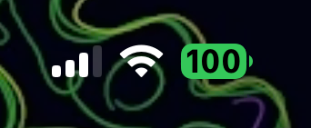

# Clear Charge

Makes the battery percentage black while the status bar battery is green. Hides the persistent charging bolt while keeping the brief plug-in animation.

Targets iOS 16 and later with a compatible battery renderer. Tested on iOS 26.0.1 with RootHide.

Enable Battery Percentage in iOS Settings, install the matching Rootless or RootHide package from [Releases](https://github.com/sahinkaa/ClearCharge/releases) and respring.

Build with `make package FINALPACKAGE=1 THEOS_PACKAGE_SCHEME=rootless`. For RootHide, use RootHide Theos and set `THEOS_PACKAGE_SCHEME=roothide`.
